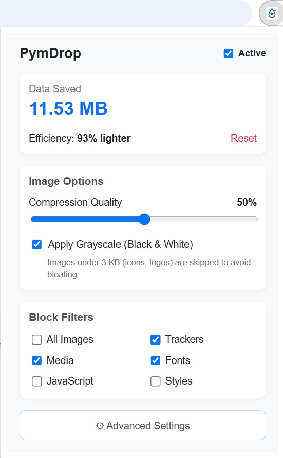

# PymDrop

> A browser extension that compresses images in real-time before they reach your screen, and blocks trackers. Save data, speed up pages, respect your privacy.

[](https://addons.mozilla.org/addon/pymdrop/)
[](https://opensource.org)
[](https://go.dev)
[](#)
[](#)



## What is PymDrop?

**PymDrop** is a two-part system designed to drastically reduce the bandwidth used while browsing:

1. **A browser extension** (Chrome and Firefox) that intercepts requests to `.jpg`/`.jpeg`/`.png` images before they are downloaded, and redirects them to a proxy server.
2. **A Go proxy server** that decodes the image, optionally applies grayscale, and re-encodes it to WebP at a configurable quality.

The typical result on unoptimized websites is an **80–90% reduction in image weight**, with noticeable improvements in loading speed and mobile data consumption. It also blocks trackers, ads, and telemetry domains.

### Why was this built?
The project was heavily inspired by the original [Compy project](https://github.com/barnacs/compy) (an HTTP forward proxy from 2015). While Compy worked via a browser proxy (requiring users to configure PAC files and trust root certificates), **PymDrop modernizes this concept for the Manifest V3 browser extension era**, making it accessible to anyone with a single click.

### The Name and Logo
The name **PymDrop** merges technical identity with the metaphor of lightness. "Pym" gives it a modern, brandable touch, while "Drop" represents the fluidity of optimized data and the literal "dropping" of dead weight from web pages. 

The icon materializes this concept: a geometric drop containing a data funnel (the decreasing bars), showing the proxy reducing traffic. The small sparkle (inherited from the original concept) symbolizes the intelligence and "magic" of the optimization. It is designed to remain perfectly legible at 16x16 pixels.

---

## How it works

```text
┌────────────────┐        1. Request for photo.jpg          ┌──────────────────┐
│                │ ──────────────────────────────────────▶  │                  │
│    Browser     │                                          │   Origin Server  │
│  + extension   │        4. Compressed WebP Image          │  (CDN or server) │
│                │ ◀──────────────────────────────────────  │                  │
└────────┬───────┘                                          └──────────────────┘
         │
         │ 2. DNR redirects to proxy
         ▼
┌────────────────────────────────────────────┐
│           PymDrop Server (Go)              │
│  ┌──────────────────────────────────────┐  │
│  │  3. Decode JPEG/PNG                  │  │
│  │     Apply optional grayscale         │  │
│  │     Re-encode to WebP                │  │
│  └──────────────────────────────────────┘  │
└────────────────────────────────────────────┘
```

1. The browser requests an image.
2. The extension uses `declarativeNetRequest` to redirect the request before it is sent to `https://your-proxy.com...`.
3. The Go server downloads the original, decodes it, applies grayscale (if requested), and re-encodes it to WebP.
4. The server returns the compressed version, or the original if the WebP file ended up larger.
5. The extension calculates the byte difference and displays it in the popup.

---

## Installation

### Prerequisites
* Go 1.23+ for the server.
* Node.js 20+ and npm for the extension.
* Chrome 120+ or Firefox 128+.

### 1. Server (Required)
You can run the Go server locally and expose it for free, or deploy it to the cloud. Detailed instructions for all three methods are in `docs/setup-server.md`.

#### Quick Start (Local + Cloudflare Tunnel)

```bash
# Terminal 1 — Server
cd server
go build -o pymdrop .
./pymdrop

# Terminal 2 — Tunnel
cloudflared tunnel --url http://localhost:8080
```

Copy the `https://...trycloudflare.com` URL that appears.

> 💡 **Optional:** A Dockerfile is provided in the `server/` folder. If you prefer containers, run:
> ```bash
> docker build -t pymdrop .
> docker run -p 8080:8080 pymdrop
> ```

### 2. Extension

#### Chrome
```bash
cd extension
npm install
npm run build
```
1. Open `chrome://extensions` → Enable **Developer mode**.
2. Click **Load unpacked** and select the `dist/` folder.
3. Open the popup, click **Advanced Settings**, and paste your Server URL.

#### Firefox

* **The easiest way:** Install directly from the [official Firefox Add-ons store](https://addons.mozilla.org/addon/pymdrop/).

* **For local development:**

```bash
cd extension
npm install
npm run build:firefox
```
1. Open `about:debugging#/runtime/this-firefox`.
2. Click **Load Temporary Add-on** and select `dist-firefox/manifest.json`.
3. Configure the Server URL in the popup.

---

## Technical Stack & Architecture

* **Go:** Chosen for the server due to its ability to compile to a single binary, its excellent concurrency model (goroutines for the CPU-bound WebP encoding), and zero CGO dependencies.
* **TypeScript & React:** Chosen for the extension UI (popup and options page) due to strong typing and component reusability.
* **Manifest V3:** Uses `declarativeNetRequest` to intercept images before they are downloaded, saving bandwidth at the network level.

For a deep dive into the architectural decisions (why not AVIF? why DNR instead of webRequest? how is SSRF handled?), read `docs/architecture.md`.

---

## Known Limitations

* **Facebook / Instagram:** These platforms use IP-signed tokens for image URLs. Because the proxy has a different IP, their CDNs reject the requests. These domains are pre-loaded into the default whitelist.
* **Private Network Access:** Chrome blocks requests from HTTPS pages to `http://localhost`. You must use a public HTTPS URL (like a Cloudflare Tunnel or Fly.io).
* **Already Optimized Images:** The extension only intercepts `.jpg`/`.jpeg`/`.png`. Sites serving WebP/AVIF natively are not touched (re-encoding WebP to WebP saves no bytes).
* **JavaScript-heavy sites:** Using the "Block JavaScript" filter will break most modern SPAs (React/Vue apps, Twitter, YouTube). Use it only on text-heavy sites or with the whitelist.

---

## Further Improvements (Roadmap)

* [ ] Implement server-side caching (LRU) to save CPU on duplicate image requests.
* [ ] Add AVIF encoding support (30% better compression, 10x slower).
* [ ] Sync the whitelist across devices using `chrome.storage.sync`.

---

## License

MIT — see `LICENSE`.

PymDrop — Because your traffic is yours.
